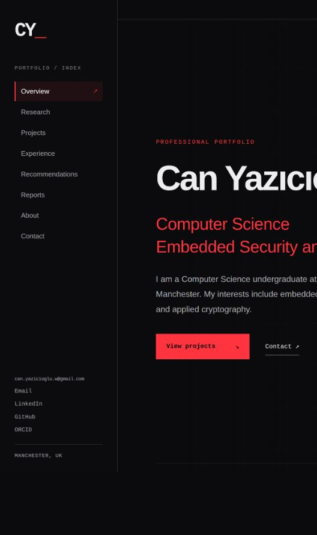
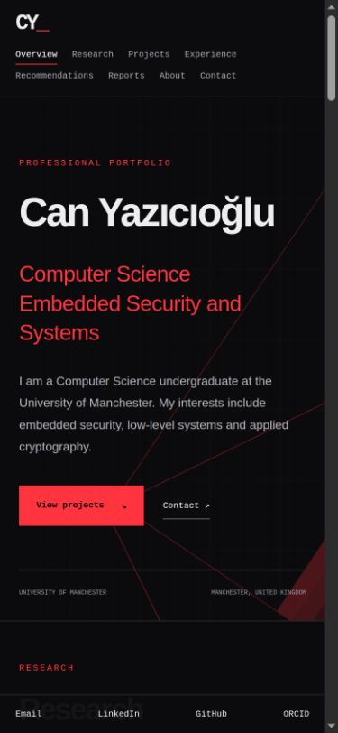
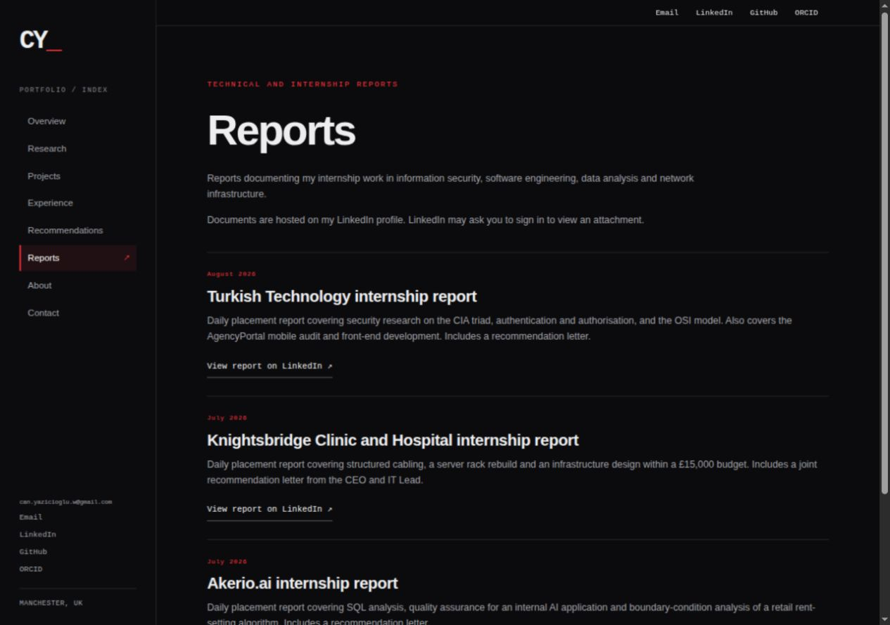

<div align="center">

# Can Yazıcıoğlu

**Computer Science · Embedded Security · Systems Research**

[View the live website](https://canyazicioglu.com) · [Reports](https://canyazicioglu.com/reports.html) · [Recommendation letters](https://canyazicioglu.com/recommendations.html)

</div>



## Explore the website

A professional portfolio presenting my research, software and hardware projects, internship experience and technical skills. The site uses a black and red palette, a narrow navigation sidebar and CSS line backgrounds. All visuals on the website are made with CSS, with no photographs or illustration assets.

| Page | What to explore |
| --- | --- |
| [Overview](https://canyazicioglu.com) | Research in hardware-based cryptographic reverse firewalls, selected projects, professional experience and education |
| [Reports](https://canyazicioglu.com/reports.html) | Internship reports from Turkish Technology, Knightsbridge Clinic and Hospital, and Akerio.ai |
| [To Whom It May Concern](https://canyazicioglu.com/recommendations.html) | Signed recommendation letters linked to their original LinkedIn attachments |

### Responsive previews

<table>
<tr><td width="30%" valign="top"></td><td width="70%" valign="top"><p>The four external contact links remain accessible throughout the site. On mobile they sit in a fixed bar at the bottom of the screen.</p></td></tr>
</table>

These screenshots show the actual website. The document pages link to original LinkedIn attachments, which may require a LinkedIn sign-in.

## Run locally

Requires Python 3 for the preview server. The website itself has no package dependencies or build step.

```sh
git clone https://github.com/can-yazicioglu/portfolio.git
cd portfolio
python3 -m http.server 8765 --directory site
```

Open [http://localhost:8765](http://localhost:8765). Use an HTTP server so the root-relative page links work correctly.

## Implementation

- Semantic HTML and a single shared stylesheet
- Responsive sidebar navigation and a persistent contact bar
- IntersectionObserver for the active section indicator
- Keyboard focus styling, skip navigation and reduced-motion support
- Cloudflare security headers, a sitemap and robots.txt
- No tracking scripts, third-party fonts or runtime API calls

```text
site/
  index.html             Research, projects, experience and contact
  recommendations.html   Recommendation letter directory
  reports.html           Internship report directory
  style.css              Shared layout, typography and CSS line backgrounds
  script.js              Active navigation and footer year
  _headers               Cloudflare response headers
  robots.txt             Crawler instructions
  sitemap.xml            Public page index
docs/previews/           Actual desktop and mobile screenshots
```

## Deployment

The live website runs on Cloudflare Workers with static assets and the custom domain `canyazicioglu.com`. Upload the **contents of `site/`** as the deployment root. There is no build command.

The GitHub repository contains the source and demonstration assets. Deployment is managed separately in Cloudflare. No credentials or account configuration are committed.

## Contact

[Email: can.yazicioglu.w@gmail.com](mailto:can.yazicioglu.w@gmail.com) · [Website](https://canyazicioglu.com) · [LinkedIn](https://www.linkedin.com/in/canyaziciogluln/) · [GitHub](https://github.com/can-yazicioglu) · [ORCID](https://orcid.org/0009-0002-5685-7479)
